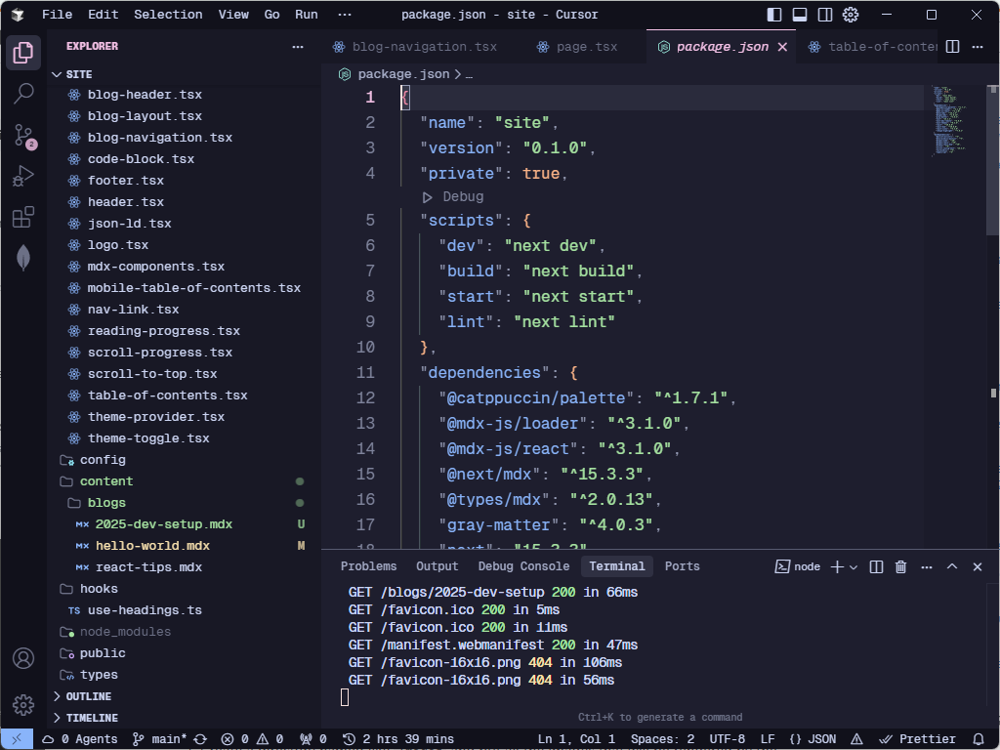
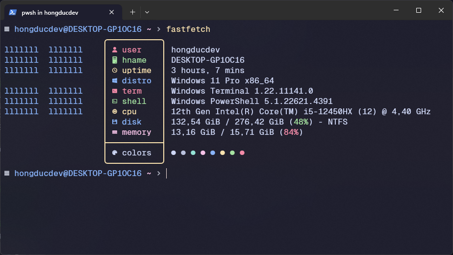

# Chào mừng đến với blog tiếp theo của mình!

Bài viết này được update vào 6/2025 vậy là chúng ta đã đi được một nửa của năm 2025 rồi. Là người hay tìm tòi các phần mềm hay thử các setting mới để tìm thấy những cảm giác thích thú trong công việc. Nhưng đây có thể là setup mà mình có đang dùng hiện tại trong vòng 1 tháng nay. Bài viết này có thể được update thêm vào cuối năm 2025 chẳng hạn.

## Code Editor (Trình soạn thảo mã nguồn)

Chúng ta sẽ bắt đầu với thứ quan trọng nhất cho một lập trình viên: code editor. Hiện tại mình đang sử dụng [Cursor](https://www.cursor.com/) cho các dự án cá nhân và [VSCode](https://code.visualstudio.com/) cho các dự án công ty. Về cơ bản thì 2 trình soạn thảo này có nhiều điểm tương đồng nhưng cũng có nhiều điểm khác biệt. Giao diện của Cursor được fork từ VSCode nên có thể sử dụng được các extension của VSCode.

Nhưng mà mình chỉ sử dụng Cursor cho các dự án cá nhân vì lý do bảo mật mã nguồn cho các dự án công ty. Dù chúng ta có thể bật Privacy Mode trong Cursor nhưng mình cũng không hoàn toàn tin tưởng vào nó. Còn ở dự án cá nhân thì mình sẽ sử dụng Cursor để tạo ra các dự án mới.



**Extension**

- UI: Mình đang sử dụng theme [Catppuccin](https://marketplace.visualstudio.com/items?itemName=Catppuccin.catppuccin-vsc) và icon [Catppuccin Noctis Icons](https://marketplace.visualstudio.com/items?itemName=AlexDauenhauer.catppuccin-noctis-icons)
- Ngoài ra mình còn sử dụng các extension khác như:
    - [ESLint](https://marketplace.visualstudio.com/items?itemName=dbaeumer.vscode-eslint)
    - [Prettier](https://marketplace.visualstudio.com/items?itemName=esbenp.prettier-vscode)
    - [Tailwind CSS IntelliSense](https://marketplace.visualstudio.com/items?itemName=bradlc.vscode-tailwindcss)
    - [ES7+ React/Redux/React-Native snippets](https://marketplace.visualstudio.com/items?itemName=dsznajder.es7-react-js-snippets)

**Setting**

Trước đó thì mình hay sử dụng font [JetBrains Mono](https://www.jetbrains.com/lp/mono/) nhưng mà khi biết đến font [Geist Mono](https://github.com/github/mononoki) thì mình đã thử và thấy nó đẹp và mình thực sự thích thứ khi sử dụng nó. Chỉ tiếc là font này chưa hỗ trợ tiếng Việt hi vọng sẽ có thể hỗ trợ trong tương lai.

Đây là file setting.json của mình:

```json
{
    "catppuccin-noctis-icons.hidesExplorerArrows": true,
    "editor.stickyScroll.enabled": false,
    "workbench.tree.enableStickyScroll": false,
    "files.autoSave": "afterDelay",
    "editor.fontFamily": "Geist Mono, 'Courier New', monospace",
    "editor.mouseWheelZoom": true,
    "editor.lineHeight": 1.6,
    "editor.formatOnPaste": true,
    "editor.formatOnSave": true,
    "editor.fontLigatures": true,
    "editor.fontSize": 16,
    "editor.fontWeight": "400",
    "prettier.tabWidth": 4,
    "editor.defaultFormatter": "esbenp.prettier-vscode",
    "color-highlight.markerType": "underline",
    "catppuccin.accentColor": "pink",
    "editor.wordWrap": "on",
    "editor.cursorBlinking": "expand",
    "editor.smoothScrolling": true,
    "git.enableSmartCommit": true,
    "[php]": {
        "editor.defaultFormatter": "bmewburn.vscode-intelephense-client"
    },
    "indentRainbow.indicatorStyle": "light",
    "indentRainbow.lightIndicatorStyleLineWidth": 2,
    "git.autofetch": true,
    "git.confirmSync": false,
    "terminal.integrated.fontFamily": "GeistMono Nerd Font Mono",
    "explorer.compactFolders": false,
    "workbench.tree.indent": 8,
    "workbench.startupEditor": "none",
    "custom-ui-style.font.sansSerif": "Geist Mono",
    "workbench.activityBar.orientation": "vertical",
    "editor.minimap.enabled": true,
    "workbench.iconTheme": "catppuccin noctis icons",
    "javascript.updateImportsOnFileMove.enabled": "always",
    "workbench.colorTheme": "Catppuccin Mocha",
    "typescript.updateImportsOnFileMove.enabled": "always"
}
```

## Terminal

Hiện tại mình đang sử dụng [Windows Terminal](https://learn.microsoft.com/en-us/windows/terminal/) để mở terminal. Mình đã cài đặt thêm [Oh My Posh](https://ohmyposh.dev/) để có thể hiển thị được nhiều thông tin hơn và có thể tùy chỉnh được giao diện của terminal.



**Setting**

- Theme: [Catppuccin Mocha](https://github.com/catppuccin/windows-terminal)
- Font: [Geist Mono](https://github.com/github/mononoki)
- Ngoài ra mình có cài đặt thêm: git, nvm, bun,...


## Trình duyệt

Mình có hai trình duyệt đang sử dụng chính là [Google Chrome](https://www.google.com/chrome/) và [Firefox](https://www.mozilla.org/en-US/firefox/new/).

Khi dev thì mình thường sử dụng Google Chrome và khi cần test thì mình sẽ sử dụng Firefox.

Có một số extension mình thường sử dụng trong trình duyệt là:

- [Visbug](https://chromewebstore.google.com/detail/visbug/cdockenadnadldjbbgcallicgledbeoc): Extension để debug trang web.
- [Mobile simulator - responsive testing tool](https://chromewebstore.google.com/detail/mobile-simulator-responsi/ckejmhbmlajgoklhgbapkiccekfoccmk): Extension để test responsive trên mobile.
- [1Password](https://chromewebstore.google.com/detail/1password-password-manag/iodihamkdnnhomgcfjnbihcldfdlhjgj): Extension để quản lý mật khẩu.
- [Ddict](https://chromewebstore.google.com/detail/ddict-ai-translation-writ/bpggmmljdiliancllaapiggllnkbjocb): Extension để dịch văn bản nhanh.

## Ngoài ra

Mình còn sử dụng các tool khác như:

- [LocalWP](https://localwp.com/): Phục vụ cho việc dev WordPress.
- [Figma](https://www.figma.com/): Phục vụ cho việc design.
- [Whatsapp](https://www.whatsapp.com/): Phục vụ cho việc trao đổi công việc.
- [Notion](https://www.notion.so/): Phục vụ cho việc ghi chép và quản lý công việc.
- [Claude](https://claude.ai/) && [Perplexity](https://www.perplexity.ai/): Phục vụ cho việc tìm kiếm thông tin hay hỏi đáp liên quan tới code.

## Kết luận

Đây là tất cả những thứ mình đang sử dụng hiện tại. Có thể sẽ có thêm nhiều thứ khác nữa nhưng mình sẽ cập nhật thêm vào cuối năm 2025.
