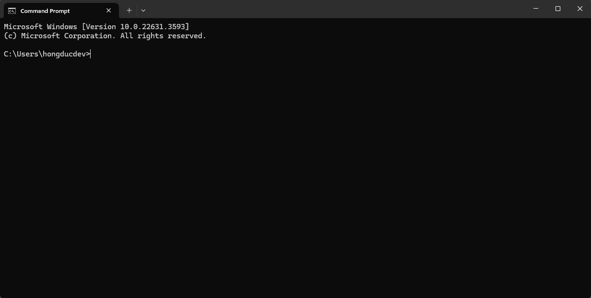
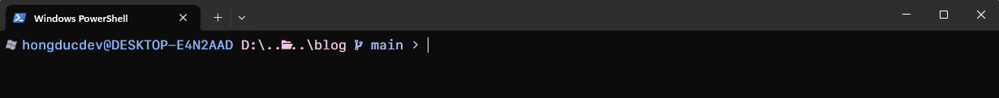
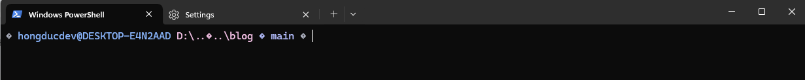
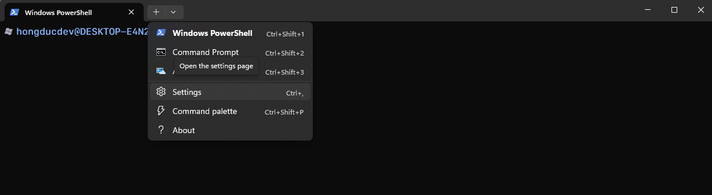
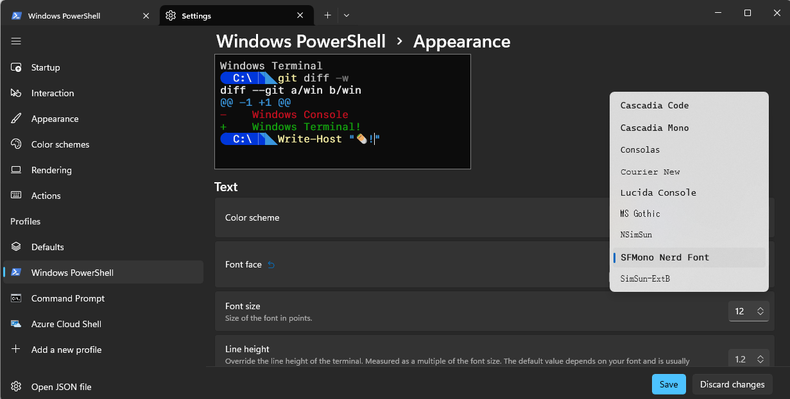
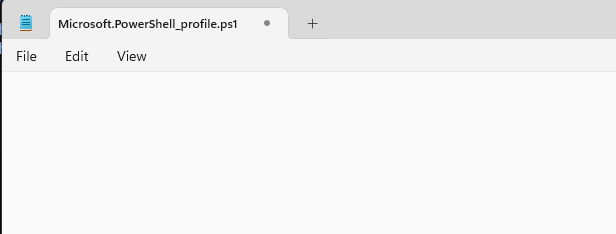
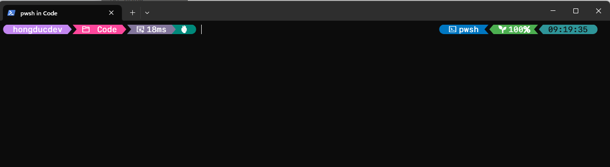
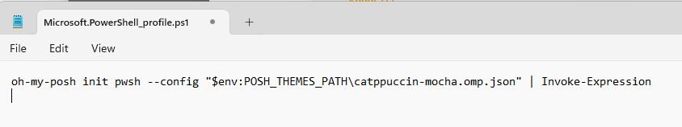

# Chào mừng đến với blog tiếp theo của mình!

Bài viết này mình sẽ hướng dẫn mọi người cách cài đặt Oh My Posh trên Windows cụ thể là trên PowerShell.

Nếu mà là một lập trình viên thì bạn đã làm việc với shell/bash trên hệ điều hành Linux/MacOS thì có thể bạn đã  biết qua một công cụ là [Oh My Zsh](https://ohmyz.sh/). Ngoài vẻ ngoài lung linh màu sắc thì có thể tích hợp các plugin hay phím tắt giúp ích cho các lập trình viên.

Ở hệ điều hành Windows thì cũng có một công cụ cũng có một công cụ có chức năng gần tượng tự là [Oh My Posh](https://ohmyposh.dev/). Tại sao mình lại nói là tượng tự? Vì phải kết hợp các công cụ khác ngoài Oh My Posh mới có thể tạo một workflow như trên Oh My Zsh.

## Chuẩn bị ban đầu

### Windows Terminal

Nếu bạn đang dùng các phiên bản bản Windows 10/11 sẽ có sẵn công cụ trên là Windows Terminal.



Nếu bạn không tìm thấy ở trên máy bạn thì bạn có thể tìm kiếm Windows Terminal trên Microsoft Store. Còn tại sao chúng ta lại chọn Windows Terminal thì bạn có thể xem video của anh Sơn Đặng F8 có giải thích cực kì chi tiết nhé 😊

[Video của anh Sơn Đặng F8](https://www.youtube.com/watch?v=egSxAF-Sak4)

### Nerd Font

Tiếp theo, các bạn tải [Nerd Fonts](https://www.nerdfonts.com/). Chúng ta sẽ sử dụng Nerd Font thi vì các font chữ mặc định trên Terminal. Vì Nerd Font hiển thị tốt các glyphs hay icon hơn các font thông thường.

**Có Nerd Font**


**Không có Nerd Font**


Về font chữ thì bạn cứ Download và Install font bình thường là có thể sử dụng được.

**Sử dụng Nerd Font trên Windows Terminal**

Bạn mở Windows Terminal chọn Settings → Windows Power Shell → Appearance → Chọn Nerd Font mà bạn đã cài đặt.



## Cài đặt Oh My Posh

Bạn mở Windows Terminal với quyền Admin để cài đặt:
```powershell
Set-ExecutionPolicy RemoteSigned
Install-Module oh-my-posh -Scope CurrentUser
```

Nếu mà bạn gặp lỗi `The term 'oh-my-posh' is not recognized as a name of a cmdlet` thì hãy chạy thêm script dưới đây:

```powershell
Set-ExecutionPolicy Bypass -Scope Process -Force; Invoke-Expression ((New-Object System.Net.WebClient).DownloadString('https://ohmyposh.dev/install.ps1'))
```

## Sử dụng Oh My Posh

Mở Powershell Profile bằng lệnh:

```powershell
notepad $PROFILE
```

Notepad sẽ hiển thị một cửa sổ với title file đang mở tên là: `Microsoft.PowerShell_profile.ps1`.


Thêm dòng sau vào file:

```txt
oh-my-posh init pwsh --config "$env:POSH_THEMES_PATH\jandedobbeleer.omp.json" | Invoke-Expression
```

Để áp dụng thay đổi thì bạn nhập lệnh sau:

```powershell
. $PROFILE
```

**Kết quả**


## Tùy chỉnh giao diện

Để tùy chỉnh giao diện thì bạn có thể tìm kiếm các theme trên [Oh My Posh Themes](https://ohmyposh.dev/docs/themes). Hoặc chạy lệnh sau để tìm kiếm:

```powershell
Get-PoshThemes
```

Khi đã lựa chọn được theme phù hợp thì chúng ta mở PowerShell Profile và edit tên theme thay cho theme mặc định. Như mình sẽ sử dụng theme `catppuccin-mocha`.


## Thêm auto-completion cho PowerShell

Để có thêm tính năng auto-completion cho PowerShell, chúng ta sẽ sử dụng PSReadLine. Đây là một module PowerShell mạnh mẽ cung cấp các tính năng như:

- Auto-completion với Tab
- Syntax highlighting
- Command history
- IntelliSense

### Cài đặt PSReadLine

PSReadLine thường đã được cài đặt sẵn trong PowerShell 5.1+ và PowerShell Core. Nếu chưa có, bạn có thể cài đặt bằng lệnh:

```powershell
Install-Module PSReadLine -Force
```

## Kết luận

Việc cài đặt Oh My Posh trên Windows PowerShell sẽ giúp bạn có một terminal đẹp mắt và dễ sử dụng hơn. Với các tính năng như:

- **Giao diện đẹp mắt**: Hiển thị thông tin Git, thời gian, và các thông tin hệ thống
- **Dễ tùy chỉnh**: Nhiều theme có sẵn để lựa chọn
- **Tích hợp tốt**: Hoạt động mượt mà với PowerShell
- **Auto-completion**: Với PSReadLine, bạn có thể sử dụng Tab để auto-complete các lệnh

Sau khi cài đặt xong, bạn sẽ có một terminal chuyên nghiệp hơn để làm việc. Đừng quên khám phá các theme khác nhau để tìm ra giao diện phù hợp với phong cách của bạn.

Nếu bạn gặp bất kỳ vấn đề nào trong quá trình cài đặt, hãy tham khảo [tài liệu chính thức của Oh My Posh](https://ohmyposh.dev/docs) hoặc để lại comment bên dưới để mình hỗ trợ thêm.

Chúc bạn thành công!
