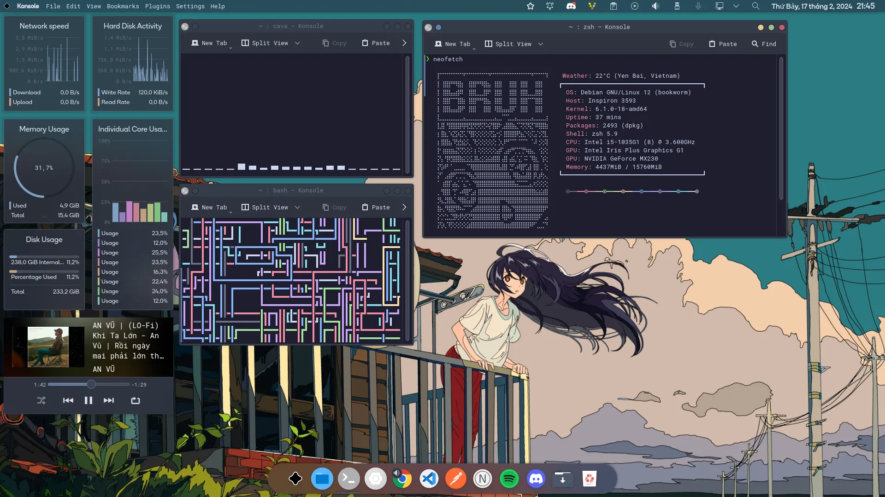
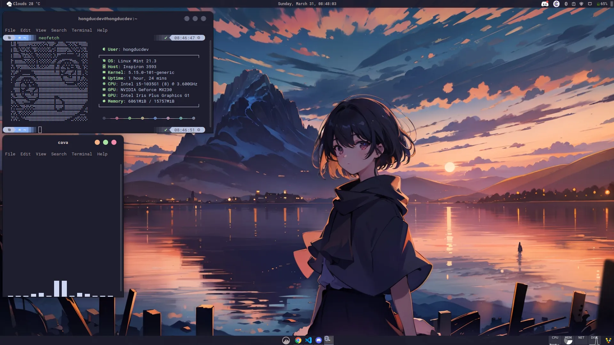

# Chào mừng đến với blog tiếp theo của mình!

Ở [blog custom Terminal trên Windows](https://www.hongducdev.com/blogs/cai-dat-oh-my-posh-tren-windows) mình cũng đã đề cập tới Zsh trên Linux/MacOS. Bây giờ mình sẽ giúp các bạn "cook" sao cho nó đẹp như này:





## Cài đặt Zsh

> Ở đây mình sẽ giới thiệu về các Linux distro có base Debian thôi nhé, các distro khác cũng chỉ khác công cụ quản lý package như Debian là apt, Fedora là dnf,...

Trước khi cài đặt thì cần update các package:

```bash
sudo apt update && sudo apt upgrade -y
```

Cài đặt `zsh`:

```bash
sudo apt install zsh
```

Chúng ta cần cài đặt thêm `git` để clone plugin sau này:

```bash
sudo apt install git
```

## Cài đặt Oh My Zsh và plugin

Cài đặt Oh My Zsh bằng curl:

> Nếu bạn nào chưa cài curl thì có thể cài đặt bằng lệnh: `sudo apt-get install curl`

```txt
sh -c "$(curl -fsSL https://raw.githubusercontent.com/ohmyzsh/ohmyzsh/master/tools/install.sh)"
```

Ở đây các bạn phải sử dụng [Nerd font](https://www.nerdfonts.com/) để hiển thị được toàn bộ các icon hay kí tự một cách đầy đủ và đẹp nhất.

Cài đặt [powerlevel10k](https://github.com/romkatv/powerlevel10k):

```bash
git clone --depth=1 https://github.com/romkatv/powerlevel10k.git ~/powerlevel10k
```

Cài đặt `zsh-autosuggestions` và `zsh-syntax-highlighting`:

```bash
git clone https://github.com/zsh-users/zsh-autosuggestions ${ZSH_CUSTOM:-~/.oh-my-zsh/custom}/plugins/zsh-autosuggestions
git clone https://github.com/zsh-users/zsh-syntax-highlighting.git ${ZSH_CUSTOM:-~/.oh-my-zsh/custom}/plugins/zsh-syntax-highlighting
```

Sau đó, ta config lại trong file `.zshrc`:

```bash
vi ~/.zshrc
```

Ở đây chúng ta sẽ để ý phần `ZSH_THEME` và `plugins`:

```txt
ZSH_THEME="powerlevel10k/powerlevel10k"
plugins=(git zsh-autosuggestions zsh-syntax-highlighting)
```

Tiếp theo bạn lựa chọn giao diện powerlevel10k theo sở thích là hoàn thành.

## Biến Terminal trở nên "ngầu" hơn

Ở đây, mình có mấy thư viện mà người dùng yêu thích "rice" Linux yêu thích như [Neofetch](https://github.com/dylanaraps/neofetch), [Cmatrix](https://github.com/abishekvashok/cmatrix):

```bash
sudo apt install neofetch cmatrix cava cbonsai
```

Để sử dụng thì mọi người chỉ cần nhập tên thư viện tương ứng vào terminal là được.

### Neofetch

Hiển thị thông tin hệ thống một cách đẹp mắt:

```bash
neofetch
```

### Cmatrix

Tạo hiệu ứng ma trận như trong phim Matrix:

```bash
cmatrix
```

### Cava

Audio visualizer cho terminal:

```bash
cava
```

### Cbonsai

Tạo cây bonsai ascii ngẫu nhiên:

```bash
cbonsai
```

## Thiết lập shell mặc định

Để đặt Zsh làm shell mặc định, bạn chạy lệnh:

```bash
chsh -s $(which zsh)
```

Sau đó logout và login lại để áp dụng thay đổi.

## Tips bổ sung

### Alias hữu ích

Bạn có thể thêm một số alias vào file `.zshrc` để làm việc hiệu quả hơn:

```bash
# Thêm vào cuối file ~/.zshrc
alias ll='ls -alF'
alias la='ls -A'
alias l='ls -CF'
alias grep='grep --color=auto'
alias ..='cd ..'
alias ...='cd ../..'
alias ....='cd ../../..'
alias c='clear'
alias h='history'
alias tree='tree -C'
```

### Plugin bổ sung

Ngoài các plugin cơ bản, bạn có thể thêm:

-   `z` - Jump to directories quickly
-   `extract` - Extract any archive
-   `colored-man-pages` - Colorize man pages

```txt
plugins=(git zsh-autosuggestions zsh-syntax-highlighting z extract colored-man-pages)
```

## Troubleshooting

### Lỗi font không hiển thị đúng

Nếu gặp lỗi font hiển thị không đúng, hãy đảm bảo:

1. Đã cài đặt Nerd Font
2. Terminal emulator đã được config để sử dụng Nerd Font
3. Locale đã được thiết lập đúng

### Powerlevel10k không hoạt động

Nếu powerlevel10k không hoạt động, thử:

```bash
echo 'source ~/powerlevel10k/powerlevel10k.zsh-theme' >> ~/.zshrc
```

## Kết luận

Giờ bạn đã có một Terminal đẹp như những hình ảnh mình chia sẻ ở đầu blog rồi.

Mọi người có thể tham khảo thêm các "rice" Linux đẹp [tại đây](https://www.reddit.com/r/unixporn/) hoặc custom như mình thì có thể tham khảo [.dotfile của mình trên Linux Mint](https://github.com/hongducdev/.dotfiles).

Chúc các bạn thành công!
